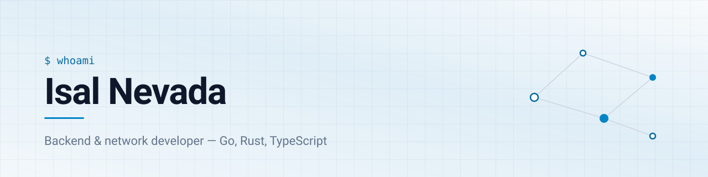

<picture>
  <source media="(prefers-color-scheme: dark)" srcset="./assets/banner-dark.svg">
  
</picture>

I build backend services and network tooling. Mostly **Go**, increasingly **Rust**, and **TypeScript** when there's a UI worth shipping. The work tends to sit close to the metal: single-binary CLI tools, SSH reverse tunnels, self-hosted infrastructure on Proxmox, and the glue that keeps it running unattended.

Most of it is private. What I can show:

### Selected work

**[portfolio](https://github.com/malasahjagotwin/portfolio)** — bilingual (id/en) personal site on the Next.js 16 App Router. Cache Components, Partial Prerendering, verified against WCAG AA rather than assumed.
 
**[proxmox-reverse-ssh](https://github.com/malasahjagotwin/proxmox-reverse-ssh)** — expose Proxmox CT/VM services behind NAT through a public VPS. systemd units, auto-reconnect, hardened sshd.
 
**[agent](https://github.com/malasahjagotwin/agent)** — bot client + installer.

### Stack

  
  
  
  
  

  
  
  
  
  
  

### Elsewhere

[proxi.cc.cd](https://proxi.cc.cd) — site, in Indonesian and English
 
[Telegram](https://t.me/tanpoint) — the fastest way to reach me
 
[Discord · Inference Hub](https://discord.gg/wQzgDVpAg5) — a community for people building with code and AI

---

Commits here are SSH-signed, so every one carries the <em>Verified</em> badge. · 
